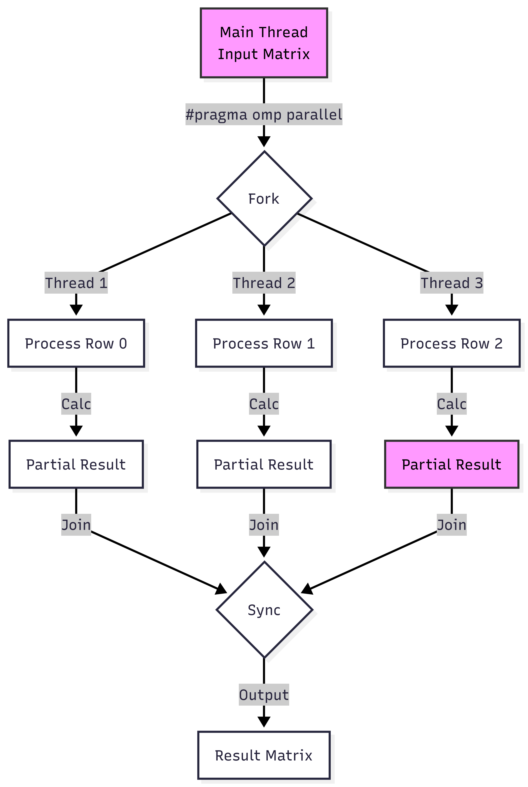

# Matrix-OpenMP-Benchmark

Parallel matrix multiplication using OpenMP, benchmarked against a serial implementation.

## Results

- Matrix size: 1000x1000
- Speedup: 3.79x over serial -- 4.25s down to 1.12s (thread count depends on available cores, uses `omp_get_max_threads()`)
- Complexity: O(N^3) -- 1 billion multiply-add operations at N=1000

## How It Works

The program multiplies two N x N integer matrices using:

1. **Serial** -- standard triple-nested loop with `clock()` timing
2. **OpenMP parallel** -- outer loop parallelized with `#pragma omp parallel for`, timed with `omp_get_wtime()`
3. **Comparison mode** -- runs both and reports speedup factor and time saved



## Build and Run

```bash
gcc -fopenmp -o benchmark matrix-openmp-benchmark.c
./benchmark
```

Choose option 3 when prompted to run both methods and see the comparison.

## Sample Output

```
Without OpenMP: 4.250000 seconds
With OpenMP:    1.120000 seconds
----------------------------------------
Speedup:        3.79x faster
Time saved:     3.130000 seconds (73.6%)
```
